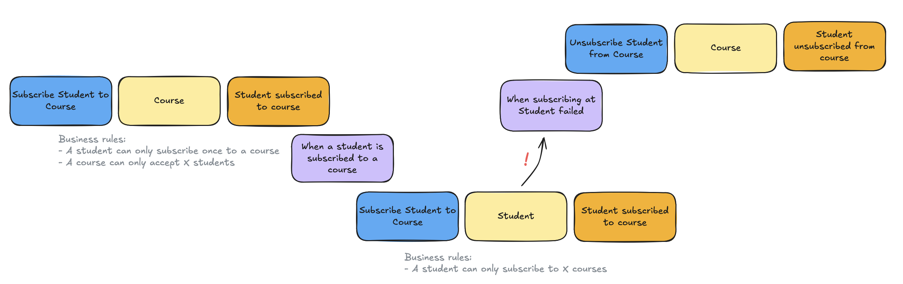
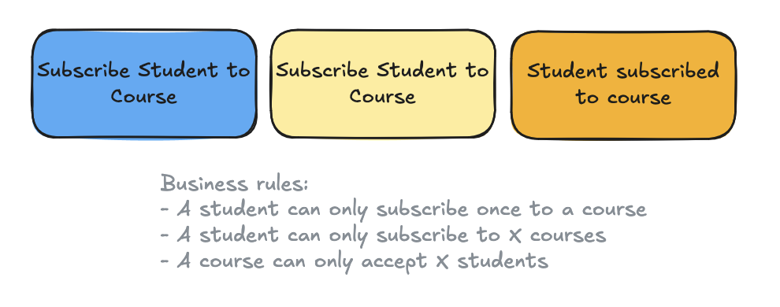

# 🫚 Gember Event sourcing
[](https://github.com/GemberPHP/event-sourcing/actions/workflows/test.yaml)
[](LICENSE)
[](http://www.php.net)

_Use case driven EventSourcing - Let go of the Aggregate with the Dynamic Consistency Boundary (DCB) pattern._

## Documentation

Full documentation is available at **[gemberphp.github.io/event-sourcing](https://gemberphp.github.io/event-sourcing/)**.

Upgrading? See [UPGRADE.md](UPGRADE.md).

## In a nutshell

#### Traditional 'Aggregate driven' EventSourcing

Domain concepts are modeled towards objects: the aggregate.

- Any business logic related to a single domain object should live inside the aggregate
- Logic that involves other domain objects or groups of the same kind of domain objects does not belong in the aggregate



#### 'Use case driven' EventSourcing
Domain concepts are modeled through use cases.

- Any business logic tied to a use case should live inside that use case
- A use case can relate to one or more domain concepts



## A simple example

A use case that subscribes a student to a course, protecting its rule against both the course's and the student's events:

```php
final class SubscribeStudentToCourse implements EventSourcedUseCase
{
    use EventSourcedUseCaseBehaviorTrait;

    #[DomainTag]
    private CourseId $courseId;

    #[DomainTag]
    private StudentId $studentId;

    private bool $isSubscribed = false;

    #[DomainCommandHandler]
    public function __invoke(SubscribeStudentCommand $command): void
    {
        if ($this->isSubscribed) {
            return;
        }

        $this->apply(new StudentSubscribedEvent((string) $this->courseId, (string) $this->studentId));
    }

    // #[DomainEventSubscriber] methods rebuild the state from past events
}
```

See the [full example](https://gemberphp.github.io/event-sourcing/example/) with domain events and a saga, [Getting started](https://gemberphp.github.io/event-sourcing/getting-started/), and the demo application [gember/example-event-sourcing-dcb](https://github.com/GemberPHP/example-event-sourcing-dcb).
