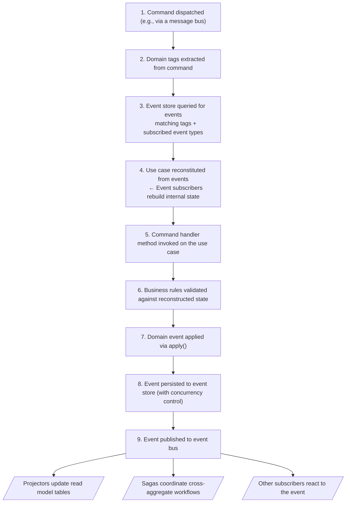
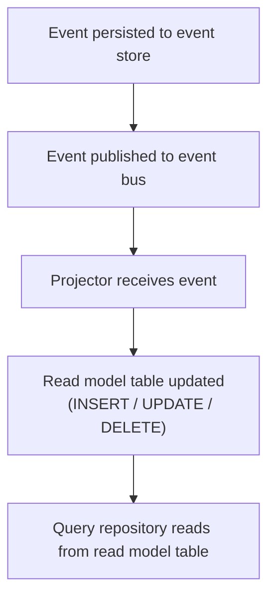

## How it works

This section explains how the core concepts of _Gember Event Sourcing_ fit together, from command dispatch to event persistence and read model updates.

### End-to-end flow

When a command is dispatched, the following process occurs:



### Event store

Events are persisted in two storage structures:

**Event store** - The primary event log:

| Field | Description |
|-------|-------------|
| `id` | Unique event ID |
| `event_name` | Event type (e.g., `course.created`) |
| `payload` | Serialized event data (typically JSON) |
| `metadata` | Additional context (e.g., user, correlation ID) |
| `applied_at` | Timestamp when the event was applied |

**Event store relations** - Links events to domain tags for efficient retrieval:

| Field | Description |
|-------|-------------|
| `event_id` | Reference to the event |
| `domain_tag` | A domain tag value from the event |

**Event store lock** - Serializes concurrent writes per consistency boundary:

| Field | Description |
|-------|-------------|
| `boundary_hash` | SHA-256 hash of the domain tags + event types |

When an event is persisted, a relation row is created for each `#[DomainTag]` property on the event. This allows the event store to efficiently query events when loading a use case. The query is scoped by both the domain tags (from the command) and the subscribed event types (from the use case's `#[DomainEventSubscriber]` methods), so only relevant events are loaded.

### Domain tags across components

Domain tags appear on commands, use cases, and events, each serving a different purpose:

| Component | Domain tag purpose | Example |
|-----------|-------------------|---------|
| **Command** | Which events to **load** from the event store | _"Load subscribed events tagged with this practitionerId"_ |
| **Use case** | **Consistency boundary** scope (must match command) | _"Ensure no concurrent changes to subscribed events for this practitioner"_ |
| **Event** | How to **index** the event for future retrieval | _"Index this event under both timeslotId and practitionerId"_ |

The command and use case tags must match exactly. The event tags are independent and determined by which use cases will need to load the event in the future.

### Concurrency control

_Gember Event Sourcing_ uses a two-layer concurrency strategy to ensure consistency without unnecessary contention.

#### Consistency boundaries

The domain tags and subscribed event types of a use case together define its **consistency boundary** — the set of events it depends on. This boundary determines the lock scope:

- **Broader tags** (e.g., `practitionerId`) widen the scope across more events
- **Narrower tags** (e.g., `timeslotId`) limit the scope to fewer events
- **Subscribed event types** further narrow the scope — events of other types are not part of the boundary

Two writers conflict when one of them appends an event that falls within the other's boundary: an event of a type the other subscribes to, tagged with at least one of the other's domain tags. Their boundaries do not need to be identical — overlapping is enough. For example, subscribing student 1 and student 2 to the same course conflict, as both depend on the subscriptions of that course.

Using the DCB pattern, unrelated changes don't conflict. For example, renaming a course and enrolling a student don't conflict, as neither appends an event of a type the other subscribes to: neither fails because of the other.

#### How writes are serialized

When a use case is saved, the event store performs the following steps atomically within a single database transaction:

1. **Acquire boundary locks** — A dedicated lock table holds one row per (domain tag, event type) pair. The writer locks every pair it reads (its domain tags × its subscribed event types) and every pair it writes (each appended event's domain tags × its event type). All rows are locked exclusively in a single statement, in a fixed (sorted) order to prevent deadlocks; missing rows are created first. Any two conflicting writers share at least one pair, so they are serialized — one blocks until the other commits. Writers that share no pair proceed concurrently.

    Pairs that are only read are locked exclusively as well. Writers reading the same pair therefore wait for each other, even when they don't conflict. For example, renaming a course and enrolling a student both subscribe to the event that created the course, so for the same course they run one after the other — but neither fails. The lock table grows by one row per distinct (domain tag, event type) pair.

2. **Check the optimistic lock** — With the boundary locks held, the event store counts the events matching the use case's domain tags and subscribed event types, and compares the count to the number of events the use case was based on when loading. Events are append-only, so if another writer committed a matching event in between, the count has changed and an `OptimisticLockException` is thrown. Comparing counts (rather than, for example, the ID of the newest event) doesn't depend on timestamps or commit order: an event that commits late with an earlier timestamp is detected as well.

3. **Persist events** — If the check passes, the new events are inserted within the same transaction.

4. **Commit** — The transaction commits, releasing the boundary locks.

When the event store is called within an already active transaction (e.g. when using the outbox), it runs inside that transaction instead of opening a savepoint, and the locks are held until it commits. In that case:

- **Roll back on any exception.** The transaction may contain part of the events (e.g. when a deadlock or duplicate event ID occurs halfway), so it must never be committed after the event store threw. Deadlocks are retryable: roll back and retry the whole operation.
- **Loading inside the same transaction is detected.** Under MySQL's default `REPEATABLE READ`, a transaction reads from a snapshot taken at its first read. If that happened before saving (for example when a middleware wraps the whole command handler, including loading), the optimistic lock check would count from that old snapshot. To detect this, every writer increments a version on the lock rows it writes; after acquiring its locks, the event store compares the versions of the lock rows it reads as seen by the transaction's snapshot with the latest committed versions. If another writer committed a matching event after the snapshot, they differ and an `OptimisticLockException` is thrown, so the command is retried with fresh data.

```
Writer A                                Writer B
────────                                ────────
BEGIN TRANSACTION                       BEGIN TRANSACTION
Acquire boundary locks ✓                Acquire boundary locks → blocks...
Check event count ✓                        │
Insert events                               │
COMMIT (releases locks)                     │
                                        ...resumes
                                        Check event count → mismatch!
                                        ROLLBACK + OptimisticLockException
```

This two-layer approach avoids the classic time-of-check-time-of-use (TOCTOU) race condition that would occur if the lock check and the write were separate operations.

The Doctrine DBAL event store supports MySQL and MariaDB (InnoDB) and SQLite; other database platforms throw an `UnsupportedPlatformException`.

!!! note "Upgrading from per-boundary locks"
    Earlier versions locked a single row per exact boundary. Old and new versions lock different rows and therefore don't serialize against each other: don't run them side by side, deploy as a cut-over. The old lock rows are no longer used; they are harmless and can be deleted once no old version is running.

#### Saga concurrency

A saga's state is saved as a whole after each event, so two events handled at the same time for the same saga could otherwise overwrite each other's changes. The saga store prevents this with an optimistic revision:

1. **Load** — the saga is loaded together with its current revision.
2. **Handle** — the event subscriber changes the saga in memory and records commands.
3. **Save** — the saga is only saved while it's still at the revision it was loaded with (`UPDATE … WHERE id = ? AND revision = ?`), and its revision is increased. If another process saved it in between, the save is rejected with a `SagaConcurrencyException`.
4. **Retry** — handling the event is attempted up to 5 times in total, with a short, randomized and growing pause in between: the saga is reloaded (now including the other process's change), the subscriber runs again, and the saga is saved. Recorded commands are only dispatched after a successful save, so a rejected attempt never dispatches commands. When all attempts fail, a warning is logged and the exception is rethrown (with the [Outbox](usage/outbox.md), the message is then retried later).

Only a saga instance loaded from the saga store (or newly created by the framework) is saved as an update. Any other instance, such as a clone or an instance that was serialized and unserialized elsewhere, is saved as a new saga: as its Saga IDs belong to the stored saga already, that save is rejected (and retried with the stored saga).

!!! warning "Inside a transaction you own"
    A retry needs a fresh transaction: the transaction of the rejected attempt still holds its writes and, under `REPEATABLE READ`, keeps reading the old state. When a transaction is already active when the saga starts handling the event (for example a `doctrine_transaction` middleware around a command handler that dispatches events synchronously), the save isn't retried: the `SagaConcurrencyException` is rethrown, and the owner of that transaction should roll back and retry the whole unit of work.

    Always roll back your transaction when a saga store exception reaches it: the failed save may have written part of its changes within that transaction.

**A Saga ID value belongs to at most one saga instance per saga name**, across all its Saga ID names; values are compared case-sensitively. A new saga is only created when none of the event's Saga IDs belongs to a saga, so when one of its Saga IDs turns out to be taken while saving, another process created the saga concurrently: the save is rejected and retried as above, and the retry finds the saga created by the other process. Adding a Saga ID value to an existing saga while it belongs to another saga instance is rejected with a `SagaIdAlreadyInUseException`, which isn't retried: it can't succeed later. Sagas with a different saga name can use the same Saga ID values.

When an event carries several Saga IDs, they are handled together: the saga instance owning any of them handles the event, and is only created (with `CreationPolicy::IfMissing`) when none of them belongs to a saga yet. Any of the event's Saga IDs not belonging to that instance can only belong to other, existing instances, which then handle the event as well. Each `#[SagaEventSubscriber]` method subscribed to the event is invoked.

A saga instance normally handles such an event once. If another process adds the event's remaining Saga ID to the same instance at that very moment, it can handle the event a second time, which is one more reason for idempotent subscribers.

Event subscribers should still be idempotent: an event can be delivered again (for example when the outbox retries a failed dispatch).

### CQRS and the read side

_Gember Event Sourcing_ implements the write side of CQRS (Command Query Responsibility Segregation). The read side is typically built using **projections** (also called read models or projectors).

#### Write side (event store)

The event store is the single source of truth. State is reconstructed by replaying events through use case event subscribers. This provides strong consistency through boundary locking and optimistic lock checks.

#### Read side (projections)

After events are persisted, they are published to an event bus. **Projectors** subscribe to these events and maintain denormalized read model tables optimized for queries:



Projectors are not part of the _Gember Event Sourcing_ library itself - they are built using your framework's messaging capabilities (e.g., Symfony Messenger). The library handles event persistence and publishing; your application handles projecting events into read models.

#### Consistency model

| Side | Consistency | Description |
|------|-------------|-------------|
| Write (event store) | Strong | Atomic writes with boundary locking per stream query (domain tags + subscribed event types) |
| Read (projections) | Eventual | Updated after events are persisted and published |

With synchronous event transport, read models are updated immediately after the write completes. Asynchronous transport introduces a delay but improves throughput.

> **Note:** By default, events are dispatched synchronously after persistence. If the process crashes between persisting and dispatching, events can be lost. The [Outbox](usage/outbox.md) pattern solves this by writing events to an outbox table atomically with the event store, then dispatching them via a background processor with at-least-once delivery guarantees.

### Saga store

Sagas are persisted directly (not event-sourced) in a saga store with two structures:

| Structure | Purpose |
|-----------|---------|
| Saga store | Stores serialized saga instances (ID, name, payload, timestamps, revision) |
| Saga store relations | Links Saga ID values to saga instances for routing; unique per saga name and Saga ID value |

Concurrent changes to a saga are detected with its revision, see [Saga concurrency](#saga-concurrency).

When a domain event is published, the saga framework extracts `#[SagaId]` values from the event and uses the saga store relations to find the correct saga instance to invoke.
